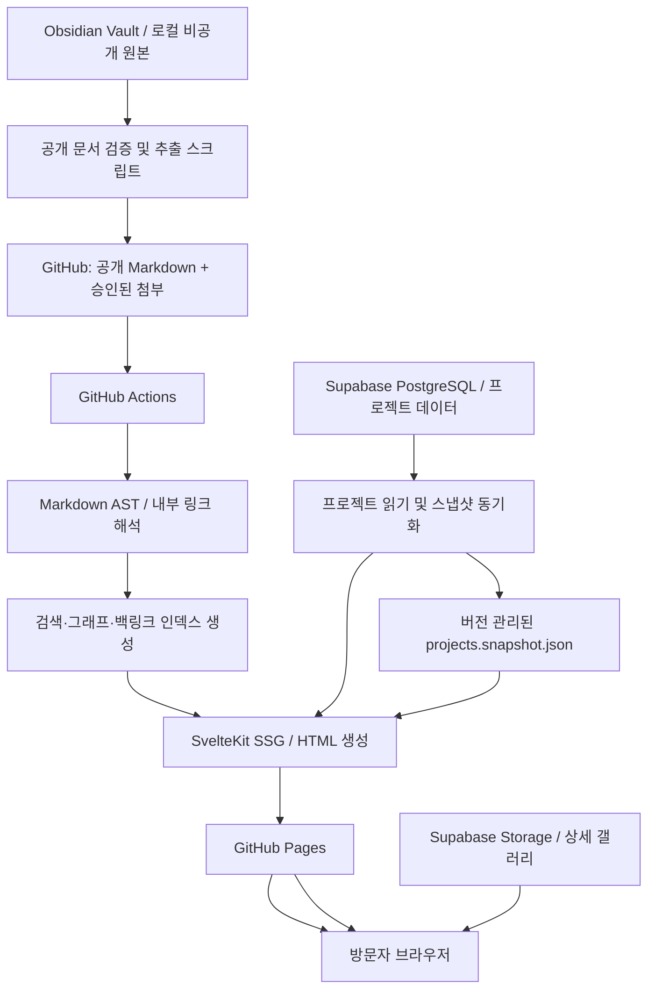

# Personal Digital Garden — 상세 구현 계획서

> **목적:** Obsidian을 콘텐츠 작성 도구로 사용하고, 개인 포트폴리오·기술 블로그·상호 연결된 지식 노트(디지털 가든)를 하나의 정적 웹사이트로 구축한다.  
> **문서 버전:** v1.0  
> **작성 기준일:** 2026-11-05  
> **상태:** 구현 전 설계안  
> **목표 비용:** 월 0원 / 결제 카드 등록 없이 시작  
> **참조 사례:** [Quartz](https://github.com/jackyzha0/quartz) (2026-11-05 기준 기본 브랜치 `v5`)

---

## 0. 의사결정 요약

### 0.1 최종 권장안

| 영역 | 채택 기술 | 결정 이유 |
|---|---|---|
| 개발 언어 | TypeScript | 콘텐츠 파이프라인과 프론트엔드 도구 통합 |
| 웹 프레임워크 | **SvelteKit + Svelte 5 Runes** | SSG, 동적 UI, 컴포넌트 재사용, 직접 구현의 자유도 |
| 스타일링 | Tailwind CSS 4 + CSS 변수 | 빠른 구성 및 디자인 토큰 관리 |
| 정적 배포 | **GitHub Pages** | 정적 HTML/CSS/JS 무료 제공, 별도 서버 불필요 |
| 빌드/배포 | **GitHub Actions** | Git push 기반 자동 빌드·배포 |
| 콘텐츠 원본 | **Obsidian Vault의 Markdown** | 오프라인 작성·지식 연결·버전 이력 관리 |
| 공개 콘텐츠 저장 | GitHub의 선별된 Markdown | 정적 생성, SEO, 장애 내성 확보 |
| 포트폴리오 메타데이터 | **Supabase PostgreSQL** | 프로젝트 정보 및 이미지 목록 관리 |
| 프로젝트 갤러리 | **Supabase Storage** | 대형 이미지·스크린샷과 정적 사이트 분리 |
| 핵심 썸네일/블로그 삽화 | GitHub 정적 자산 | DB/Storage 일시 중지 때에도 핵심 페이지 유지 |
| 검색 | 브라우저 로컬 검색 인덱스(FlexSearch) | DB 호출 없이 사이트 전체 검색 |
| 문서 그래프 | 빌드 타임 링크 인덱스 + D3 | Wikilinks/Backlinks/Graph View 구현 |
| 마크다운 처리 | Unified / Remark / Rehype | Markdown AST 기반 확장 가능한 변환 |
| 서버 | **없음** | Rails, 상시 API 서버, 서버 DB 연결 제거 |

**핵심 원칙:** 글의 원본은 Markdown이고, GitHub Pages는 그 정적 결과물을 제공한다. Supabase는 포트폴리오 데이터·상세 이미지 저장에만 활용하며 **블로그 조회의 필수 의존성이 되지 않도록 설계**한다.

### 0.2 왜 Ruby on Rails가 아닌가

- GitHub Pages는 Rails 프로세스 및 서버 측 요청 처리를 실행하지 않는다.
- Rails의 강점(서버 라우팅, ActiveRecord, 인증, 관리 CRUD)을 사용하려면 별도 호스팅과 운영이 필요하다.
- 본 서비스의 핵심은 **Markdown을 사전 변환하고 링크 그래프를 빌드하여 정적 페이지로 배포하는 것**이다.
- Ruby가 꼭 필요하다면 Rails보다는 Jekyll이 정적 배포와 잘 맞지만, Obsidian 고유 문법·그래프를 직접 구현해야 한다.
- **권장:** Quartz의 구현 아이디어를 참고하되, 자체 SvelteKit 애플리케이션을 개발한다. Quartz 구성 요소를 Svelte 컴포넌트로 직접 가져다 쓸 수 있다고 가정하지 않는다.

### 0.3 기본 설계 결정(ADR 초안)

| ID | 결정 | 대안 / 비고 |
|---|---|---|
| ADR-001 | SvelteKit 정적 프리렌더링 사용 | SSR API 서버 배포는 범위 외 |
| ADR-002 | **개인 전체 Vault 공개 금지**, 명시적으로 게시할 문서만 추출 | `publish: true` 허용 목록 방식 |
| ADR-003 | 글·노트는 Markdown을 단일 원본으로 취급 | DB에 글 전문을 중복 관리하지 않음 |
| ADR-004 | 프로젝트 DB는 Supabase, **읽기용 정적 스냅샷** 유지 | 비활성·네트워크 오류 시 대체 표시 |
| ADR-005 | 운영 초기 관리자 UI는 만들지 않음 | Supabase Dashboard + Git으로 관리 |
| ADR-006 | 검색·그래프·백링크는 빌드 타임 생성 | 초기에 검색 서버/벡터 DB 불필요 |
| ADR-007 | 포트폴리오의 대표 이미지와 핵심 소개는 정적 자산 | Supabase 장애 시에도 표시 |
| ADR-008 | 최초 배포는 사용자 사이트(`username.github.io`)를 우선 | 프로젝트 사이트라면 `paths.base` 설정 |

---

## 1. 목표와 범위

### 1.1 프로젝트 목표

1. **개인 브랜딩:** 자기소개, 경력, 기술 스택, 프로젝트와 외부 링크를 일관된 디자인으로 공개.
2. **기술 블로그:** Obsidian에서 작성한 기술 문서를 Markdown 기반으로 게시하고 코드·수식·다이어그램 표시.
3. **디지털 가든:** 문서를 읽는 순서에 제한이 없는 탐색 경험 제공. Wikilinks, Backlinks, 태그, 검색, 관계 그래프 구현.
4. **오프라인 우선 작성:** 콘텐츠 작성은 로컬 Obsidian에서 수행; 게시할 때만 GitHub로 동기화.
5. **운영비 최소화:** GitHub Pages/Supabase Free 한도 내 운영, 결제 카드 없는 시작 조건 유지.
6. **확장 가능한 설계:** 추후 SvelteKit 관리자 화면, 댓글, RSS, 다국어, AI 검색 등 기능을 추가할 수 있도록 모듈화.

### 1.2 주요 사용자

- **방문자:** 포트폴리오 확인, 프로젝트 스크린샷 열람, 글 검색, 문서 사이 탐색.
- **사이트 소유자:** Obsidian에서 글 작성, 게시 여부 지정, 프로젝트 정보·이미지 편집, 변경 사항 배포.

### 1.3 MVP에 포함

- 반응형 홈/소개/프로젝트 목록/상세/블로그 목록/글 상세/노트 목록/노트 상세.
- Obsidian Markdown의 일반 요소, YAML Frontmatter, 기본 Wikilinks 및 임베드 이미지.
- 게시 승인 필터, 고정 URL, 내부 링크 검사.
- 검색, 태그 필터, 백링크, 폴더별 탐색.
- 다크 모드, TOC, 코드 구문 강조, 모바일 레이아웃.
- Supabase 프로젝트 정보 및 갤러리 이미지 연동.
- GitHub Actions 자동 배포와 장애 시 기본 정적 콘텐츠 제공.
- SEO 메타데이터, Sitemap, RSS, 접근성 기본 점검.

### 1.4 초기 범위에서 제외

- Rails 서버, 상시 실행 API 서버, 실시간 협업/수정 기능.
- 방문자 계정·권한·파일 업로드·댓글 시스템.
- Obsidian 플러그인 전체 호환, 양방향 동기화.
- 전문 검색 서버, 벡터 검색, LLM RAG, 실시간 구독 알림.
- 동영상 파일 호스팅, 대용량 배포 파일 보관.
- 개인 정보가 포함된 비공개 노트의 배포 및 인증을 통한 열람.

---

## 2. 비기능 요구사항과 수용 기준

| 구분 | 목표 | 검사 방법 |
|---|---|---|
| 가용성 | Supabase DB가 중지되어도 홈/블로그/노트 정상 열람 | 네트워크 차단 테스트 |
| 비용 | 무료 플랜 안에서 운영, 무카드 시작 | 대시보드 요금제/사용량 확인 |
| SEO | 게시 글마다 독립 HTML, title, description, canonical, sitemap 생성 | JS 비활성화 후 HTML 확인 |
| 성능 | 일반 페이지 Lighthouse Performance 90+ 목표 | 모바일 기준 Lighthouse 측정 |
| 접근성 | WCAG 2.2 AA의 주요 항목 지향 | 키보드 탐색, 색 대비, axe 검사 |
| 안정성 | 깨진 내부 링크는 배포 전에 검출 | 콘텐츠 검증 스크립트/CI |
| 보안 | 비공개 Vault 원문·API 비밀 키·비공개 첨부 미게시 | 빌드 아티팩트 검색/권한 테스트 |
| 모바일 | 360px ~ 데스크톱 반응형 | 브라우저 뷰포트 테스트 |
| 유지보수 | 원고 수정·게시 절차 1개의 명시적 워크플로 | 게시 시나리오 E2E |
| URL | 슬러그 변경 없이 지속적 접근 | 기존 URL 및 리디렉션 테스트 |

> 성능·접근성 수치는 개발 목표이지 현재 구현된 결과가 아니다.

---

## 3. 시스템 아키텍처

### 3.1 논리 구조



### 3.2 데이터의 소유권

| 데이터 종류 | 유일 원본(Source of Truth) | 배포 시 사용 형태 |
|---|---|---|
| 블로그/노트 본문 | 개인 Obsidian Markdown | 공개 Markdown → 정적 HTML |
| 글/노트 메타데이터 | Markdown Frontmatter | JSON 메타 인덱스 + HTML |
| Wikilinks / Backlinks | 게시된 Markdown의 링크 | 빌드 생성 JSON |
| 검색 인덱스 | 게시된 Markdown 본문 | 빌드 생성 JSON |
| 프로젝트 제목·상세·기술스택 | Supabase PostgreSQL | 빌드된 HTML + 정적 스냅샷 |
| 프로젝트 상세 스크린샷 | Supabase Storage | 공개 URL (필요시 정적 대체 자산) |
| 대표 프로젝트 썸네일 | GitHub 정적 자산 | 빌드 결과에 포함 |
| 프로필·소개/고정 메뉴 | SvelteKit 소스/정적 데이터 | 빌드 결과에 포함 |

### 3.3 동기화 방향

- **글:** Obsidian → 게시 스크립트 → GitHub → Actions → Pages (단방향).
- **프로젝트:** Supabase Dashboard → Postgres/Storage → 데이터 동기화 → 정적 빌드/갤러리 표시.
- **글을 DB로 역동기화하지 않음.** 충돌, 중복 원본, 편집 지점 분산을 방지.
- **프로젝트 수정을 즉시 반영하려면:** 추후 클라이언트 데이터 조회를 추가할 수 있지만, MVP에서는 **빌드된 스냅샷이 기본**이다. 배포는 수동 GitHub Actions 실행 또는 소스 변경 트리거.

### 3.4 Supabase 일시 중지 대응

Supabase 무료 프로젝트는 낮은 활동량이 일정 기간 지속되면 일시 중지될 수 있다. **저장소에 포함된 읽기용 스냅샷**이 있으면 DB 정지 상태에서도 프로젝트 목록과 설명이 유지된다. 외부 Storage 이미지의 가용성은 별개이므로 **대표 이미지와 홈의 주요 이미지**는 GitHub에 보관한다.

권장 구현:

1. `scripts/sync-projects.ts`가 Supabase에서 `published = true`인 프로젝트를 읽는다.
2. 응답 스키마를 검증하고 `src/lib/generated/projects.snapshot.json`에 저장한다.
3. 통신 실패 시 기존 파일을 덮어쓰지 않고 이전 스냅샷으로 계속 빌드한다.
4. 수동 `npm run sync:projects`를 실행해 스냅샷 갱신 후 Git commit/push한다.
5. 브라우저에서는 먼저 정적 스냅샷을 표시한다. 실시간 조회는 추후 선택 기능으로 둔다.
6. 이미지 로드 실패 시 같은 프로젝트의 GitHub 정적 썸네일 또는 기본 이미지로 교체한다.

> 프로젝트에 추가한 내용이 배포 없이 실시간 반영되지는 않는다. 이는 정적 사이트의 안정성을 우선하는 의도적인 트레이드오프다.

---

## 4. 화면 및 정보 구조(IA)

### 4.1 사이트맵

```text
/
├── /about/                      자기소개·경력·연락 링크
├── /projects/                   프로젝트 목록, 기술 필터
│   └── /projects/[slug]/        프로젝트 상세·갤러리
├── /blog/                       정돈된 기술 아티클 목록
│   └── /blog/[slug]/            긴 글·실습·튜토리얼
├── /garden/                     지식 노트 목록/지도
│   └── /garden/[slug]/          연결된 개별 노트
├── /tags/[slug]/                태그별 콘텐츠 목록
├── /search/                     검색 결과 (또는 모달)
├── /graph/                      전체 지식 그래프 (후속 단계)
├── /rss.xml                     RSS
├── /sitemap.xml                 Sitemap
└── /404.html                    정적 404
```

블로그와 디지털 가든을 콘텐츠 유형으로 구분하되, **한 문서가 다른 문서를 참조하는 관계는 두 영역 모두에서 추적**한다.

### 4.2 공통 레이아웃

- 상단: 사이트 이름, 전체 검색, 홈/프로젝트/블로그/가든, 다크 모드.
- 본문: 페이지 제목, 개요, 최종 수정일, 태그, 본문.
- 기술 글 상세: 데스크톱 우측 TOC, 모바일 접기 메뉴, 코드 복사.
- 가든 노트: 좌측 Explorer, 중앙 본문, 우측 Backlinks/Local Graph.
- 하단: 관련 문서, 이전/다음 또는 연관 글, GitHub 링크.

### 4.3 포트폴리오 콘텐츠 모델

프로젝트 카드: 제목, 1문장 설명, 기술 태그, 역할, 대표 이미지, 상태, GitHub/데모 링크.  
프로젝트 상세: 문제 정의 → 요구사항 → 아키텍처 → 핵심 구현 → 스크린샷 → 기술적 의사결정 → 회고.

### 4.4 디자인 원칙

- 텍스트 가독성과 코드 블록의 대비를 우선한다.
- 기본 콘텐츠 폭 720~820px, 전체 가든 레이아웃은 더 넓게 허용한다.
- 색상·타이포그래피·간격·테두리·반경을 CSS 변수로 정의한다.
- 그래프, 검색 모달 등 무거운 상호작용은 필요한 페이지에서만 동적 로드한다.
- 애니메이션은 `prefers-reduced-motion`에 따라 축소한다.

---

## 5. 저장소 및 디렉터리 설계

### 5.1 두 저장 공간을 분리

**A. 개인 Obsidian Vault (비공개, 로컬 또는 별도 비공개 저장소)**

```text
MyVault/
├── 00-Inbox/
├── 10-Blog/
├── 20-Notes/
├── 30-Projects/
├── 90-Private/
├── _attachments/
└── .obsidian/
```

**B. 공개 사이트 저장소 (`username.github.io` 권장)**

```text
personal-garden/
├── content/                      # 검증을 통과한 공개 Markdown만
│   ├── blog/
│   ├── garden/
│   └── assets/                   # 게시 글에서 참조한 승인된 첨부
├── scripts/
│   ├── publish-notes.ts          # 비공개 Vault → 공개 데이터 선별
│   ├── validate-content.ts       # frontmatter/링크/첨부/비공개 차단
│   ├── build-content.ts          # 링크·백링크·검색 인덱스 생성
│   ├── sync-projects.ts          # Supabase → 정적 스냅샷
│   └── optimize-images.ts        # WebP/썸네일 생성
├── src/
│   ├── lib/
│   │   ├── components/
│   │   │   ├── layout/
│   │   │   ├── article/
│   │   │   ├── garden/
│   │   │   ├── projects/
│   │   │   └── common/
│   │   ├── content/
│   │   │   ├── schema.ts
│   │   │   ├── parser.ts
│   │   │   ├── wikilinks.ts
│   │   │   ├── backlinks.ts
│   │   │   ├── graph.ts
│   │   │   ├── search.ts
│   │   │   └── slugs.ts
│   │   ├── generated/            # 빌드 중 재생성, 일부 snapshot 커밋
│   │   │   └── projects.snapshot.json
│   │   └── supabase/
│   │       └── public-client.ts  # 공개 키만 사용
│   └── routes/
│       ├── +layout.ts
│       ├── +layout.svelte
│       ├── +page.svelte
│       ├── blog/
│       │   ├── +page.svelte
│       │   └── [slug]/
│       │       ├── +page.server.ts
│       │       └── +page.svelte
│       ├── garden/
│       │   ├── +page.svelte
│       │   └── [slug]/
│       │       ├── +page.server.ts
│       │       └── +page.svelte
│       ├── projects/
│       ├── tags/
│       └── graph/
├── static/
│   ├── .nojekyll
│   ├── images/                  # 핵심 대표 이미지
│   ├── favicon.ico
│   └── robots.txt
├── supabase/
│   └── migrations/              # SQL 스키마/정책을 Git 버전 관리
├── tests/
│   ├── unit/
│   ├── integration/
│   └── e2e/
├── .github/workflows/
│   └── pages.yml
├── .env.example
├── svelte.config.js
├── vite.config.ts
├── package.json
└── README.md
```

### 5.2 저장소 보호 규칙

- `.obsidian/`, `90-Private/`, 개인 Vault 전체 경로를 공개 저장소로 복사하지 않는다.
- `.env`, 서비스 역할 키, 로컬 백업 파일, 개인 PDF/녹음 파일은 버전 관리 금지.
- 공개 저장소에는 **게시 대상과 실제 참조된 첨부 파일만** 포함한다.
- GitHub Actions 빌드 아티팩트에도 비공개 자료가 실리지 않았는지 검증한다.

---

## 6. Obsidian 콘텐츠 명세 및 게시 파이프라인

### 6.1 Frontmatter 명세

```yaml
---
id: "note-svelte-5-runes"
title: "Svelte 5 Runes 정리"
slug: "svelte-5-runes"
type: "blog"                # blog | garden
description: "Svelte 5의 반응성과 주요 Rune을 이해한다."
date: "2026-11-05"
updated: "2026-11-05"
tags: ["svelte", "typescript", "frontend"]
publish: true
aliases: ["Svelte Runes", "Svelte 5 반응성"]
cover: "assets/svelte-runes-cover.webp"
---

# Svelte 5 Runes 정리

연관 문서: [[자바스크립트 반응성]] · [[SvelteKit 구조|SvelteKit 아키텍처]]

> [!tip] 핵심 포인트
> Rune은 컴포넌트 바깥에서도 활용할 수 있다.
```

필수 필드: `id`, `title`, `slug`, `type`, `publish`.  
권장 필드: `description`, `date`, `updated`, `tags`.  
`id`는 내부 고정 식별자, `slug`는 공개 URL에 사용한다. Obsidian 파일명 변경이 URL 변경으로 이어지지 않도록 한다.

**상태 정책:**

- `publish: true`: 게시 후보; 필수 필드 및 링크 검증 통과 시 공개.
- 미기입/`false`: 무조건 비공개.
- `draft: true`: `publish: true`가 있어도 배포 제외(추가 안전장치).
- `type: blog`: 작성 순서 중심의 정돈된 글.
- `type: garden`: 연결과 축적 중심의 노트.

### 6.2 게시 동작 상세

1. 로컬 게시 스크립트가 지정된 Vault 경로를 읽는다.
2. Markdown 파일의 YAML을 파싱하고 스키마(Zod 등)를 검증한다.
3. `publish: true`이면서 `draft !== true`인 파일만 후보로 선택한다.
4. `id`, `slug`, `aliases`의 중복·충돌을 검사한다.
5. 파일별 내부 링크/이미지/첨부 참조의 의존성 그래프를 구한다.
6. 공개되지 않은 노트에 대한 `[[wikilink]]`나 `![[embed]]`는 **빌드 실패** 처리한다. 비공개 노트의 제목이나 본문이 공개 산출물에 포함되지 않도록 한다.
7. 승인된 이미지/첨부만 추출하고 허용 MIME 타입·크기·파일명 정책을 검사한다.
8. YAML과 Markdown을 정규화하여 `content/`로 복사한다.
9. `validate-content` → `build-content` → `npm run build`를 로컬에서 실행해 검증한다.
10. Git 변경 사항을 확인한 뒤 커밋/푸시한다. 자동 푸시는 초기 버전에서 사용하지 않는다.

### 6.3 Obsidian 문법 호환 단계

| 문법 | 예시 | MVP | 처리 방식 |
|---|---|---|---|
| 일반 Markdown | `# 제목`, 표, 체크리스트 | 필수 | remark-gfm |
| 기본 Wikilink | `[[문서]]` | 필수 | 링크 해석 테이블 |
| 표시 이름 | `[[문서\|표시]]` | 필수 | AST 변환 |
| 헤딩 앵커 | `[[문서#소제목]]` | 필수 | heading slug 매칭 |
| 이미지 임베드 | `![[image.png]]` | 필수 | 첨부 파일 해석 |
| Callout | `> [!note]` | 필수 | remark transformer |
| 문서 임베드 | `![[다른 문서]]` | 2단계 | 순환 참조/깊이 제한 |
| 블록 참조 | `[[문서#^block-id]]` | 3단계 | 블록 ID 인덱스 |
| 코드 강조 | ` ```ts ` | 필수 | Shiki |
| LaTeX | `$...$`, `$$...$$` | 필수 | remark-math + KaTeX |
| Mermaid | fenced `mermaid` | 2단계 | Mermaid 지연 로딩/정적 렌더 검토 |
| Canvas / Bases | `.canvas`, `.base` | 향후 | 별도 파서 필요 |

> Quartz 5의 Obsidian 호환 문서를 **기능 요구사항 참조**로 사용한다. 처음부터 100% 호환을 목표로 하지 않는다.

### 6.4 Wikilink 해석 규칙

- `[[문서명]]`은 공개 문서의 `title`/`aliases`/상대경로 후보로 해석.
- 동일 제목이 여러 파일에 존재하면 정확한 경로 지정 요구; 임의의 첫 번째 문서로 연결하지 않는다.
- `[[문서명|표시명]]`의 화면 텍스트와 참조 대상을 분리.
- 앵커 포함 링크는 대상 페이지의 실제 헤딩 ID 존재를 검사.
- 모든 링크를 `/blog/<slug>/` 또는 `/garden/<slug>/`의 정규 URL로 매핑.
- GitHub 프로젝트 사이트 배포 시 `base`를 고려하여 URL 생성.
- 링크 해석 실패/미게시 대상/중복 `slug`를 CI에서 실패시킨다.
- 그래프 노드 식별은 제목이 아니라 **불변 `id`**를 사용한다.

### 6.5 Markdown → HTML 처리 순서

```text
Markdown 원본
  → YAML Frontmatter 분리
  → Markdown AST (remark)
  → Obsidian 문법 변환 (wikilinks/callouts/embeds)
  → 내부 링크 정규화 및 검증
  → syntax highlight / math / TOC 처리
  → HTML AST (rehype)
  → 허용 목록 기반 sanitize
  → 정적 HTML 문자열 + 메타데이터
```

- 게시 원고라도 HTML 삽입 기능은 기본적으로 제한한다.
- Svelte의 `{@html ...}`로 렌더링하기 전에 신뢰 가능한 sanitization을 수행한다.
- 고유 anchor, 코드 강조 클래스, 접근성 속성에 맞는 sanitize 허용 목록을 테스트한다.
- 임의 스크립트, `javascript:` URL, 비허용 iframe, 이벤트 핸들러를 차단한다.

### 6.6 URL과 수명 주기

- `slug`는 한 번 공개하면 원칙적으로 유지한다.
- URL 변경이 불가피하면 이전 slug → 새 slug 매핑 파일을 만들고 정적 HTML 리디렉션(또는 사용자 안내 페이지)을 생성한다.
- 삭제된 글의 URL은 404 처리; 중요 글은 대체 글로 연결한다.
- `created`/`updated` 날짜는 Git 변경 이력보다 Frontmatter 값을 우선한다.

---

## 7. 디지털 가든 인덱싱 및 UX

### 7.1 링크 인덱스 생성

```ts
// 예시 데이터 타입 (설계용)
type PublicNote = {
  id: string;
  slug: string;
  type: 'blog' | 'garden';
  title: string;
  tags: string[];
  outboundIds: string[];
  updated: string;
};

type GardenIndex = {
  notes: PublicNote[];
  edges: Array<{ source: string; target: string }>;
  backlinks: Record<string, string[]>;
};
```

빌드 중 수행:

1. 전체 공개 노트 목록과 `id`/`slug`/`alias` 사전 구성.
2. 노트별 Wikilinks 추출, 실제 대상 문서 `id`로 치환.
3. 방향성이 있는 `source → target` 엣지 기록.
4. 엣지를 역변환해 `backlinks[target] = [source...]` 생성.
5. 자기 자신 링크, 중복 링크, 미존재 노드 등 예외 처리.
6. 전체 그래프와 페이지별 로컬 그래프 데이터를 JSON으로 저장.

### 7.2 그래프 구현

- 기술: D3 force simulation (초기), 데이터가 많으면 Canvas 렌더링 고려.
- 인터랙션: 줌, 드래그, 노드 선택, 관련 문서 강조, 노드 클릭 이동.
- 필터: 블로그/가든 구분, 태그, 연결 없는 노드 숨기기.
- 제한: 전체 그래프가 커질 경우 기본은 로컬 그래프; 전체 그래프는 전용 페이지에서 지연 로드.
- 모바일: 그래프를 기본 숨김/작게 표시하고 링크 목록을 주요 탐색 수단으로 제공.

### 7.3 검색 구현

- FlexSearch 또는 유사 클라이언트 검색으로 **빌드 타임** 인덱스 생성.
- 인덱스 필드: 제목(높은 가중치), 태그, 설명, 본문(중간 가중치).
- 인덱스에 **비공개·미게시 문서가 포함되지 않았는지** 테스트.
- 한국어는 영문 토큰화 가정이 통하지 않으므로 문자 n-gram(예: 2~3자), 정규화, 제목 우선 점수 등을 별도 평가한다.
- 검색 인덱스는 작은 JSON 단위로 분리하고 필요 시 로드한다.
- 검색 모달: `Ctrl/Cmd + K`, 키보드 위/아래 선택, Enter 이동, Esc 닫기.

### 7.4 탐색 구조

- Explorer: 공개 문서만 대상으로 폴더 또는 논리 카테고리별 트리 구성.
- Backlinks: 현재 글을 참조한 글의 제목·요약 표시.
- Related: 공유 태그, 링크 인접도 기반 간단한 관련 글 추천(초기에는 규칙 기반).
- TOC: 문서의 `h2`~`h4`를 기본 표시, 현재 스크롤 위치 강조.

---

## 8. Supabase DB 및 Storage 설계

### 8.1 프로젝트 테이블

```sql
-- supabase/migrations/0001_projects.sql
create extension if not exists pgcrypto;

create table if not exists public.projects (
  id uuid primary key default gen_random_uuid(),
  slug text not null unique,
  title text not null,
  summary text not null default '',
  description text,
  role text,
  tech_stack text[] not null default '{}',
  repo_url text,
  demo_url text,
  thumbnail_path text,          -- GitHub 정적 자산 경로 권장
  published boolean not null default false,
  sort_order integer not null default 0,
  created_at timestamptz not null default now(),
  updated_at timestamptz not null default now()
);

create table if not exists public.project_images (
  id uuid primary key default gen_random_uuid(),
  project_id uuid not null references public.projects(id) on delete cascade,
  object_path text not null,     -- Supabase Storage의 object key
  alt_text text not null default '',
  caption text,
  sort_order integer not null default 0
);

create index if not exists idx_projects_published_order
  on public.projects (published, sort_order);
create index if not exists idx_project_images_project_order
  on public.project_images (project_id, sort_order);

alter table public.projects enable row level security;
alter table public.project_images enable row level security;

-- 이 프로젝트는 공개 읽기만 허용; Dashboard를 통한 관리 전제
revoke all on public.projects from anon, authenticated;
revoke all on public.project_images from anon, authenticated;
grant select on public.projects to anon, authenticated;
grant select on public.project_images to anon, authenticated;

create policy "published_projects_read"
on public.projects for select to anon, authenticated
using (published = true);

create policy "published_project_images_read"
on public.project_images for select to anon, authenticated
using (
  exists (
    select 1 from public.projects p
    where p.id = project_id and p.published = true
  )
);
```

**주의:** SQL은 신규 프로젝트용 마이그레이션 예시다. 기존 정책이 있으면 `CREATE POLICY` 중복 에러가 날 수 있으므로 실제 배포 전에 로컬/개발 DB에서 검증한다. `updated_at` 자동 갱신 트리거는 추후 추가하거나 Dashboard 입력/배포 스크립트에서 갱신한다.

### 8.2 RLS 테스트 시나리오

- `anon`은 `published = true`인 프로젝트만 조회 가능.
- `anon`은 미게시 프로젝트의 이미지 메타데이터 조회 불가.
- `anon`과 일반 `authenticated` 사용자는 INSERT/UPDATE/DELETE 거부.
- 공개 JS 번들에는 Publishable Key만 존재; Secret/Service Role 키는 없음.
- DB 레코드에 비공개 메모, 암호, 고객 자료 등 민감 정보를 저장하지 않는다.

### 8.3 Storage 구성

| 버킷 | 공개 여부 | 내용 | 수정 권한 |
|---|---|---|---|
| `portfolio-images` | Public | 프로젝트의 공개 이미지/WebP | Dashboard 관리자 |
| `private-assets` | **초기 생성하지 않음** | 개인 자료는 로컬에서 보관 | 해당 없음 |

경로 예시:

```text
portfolio-images/
  contech-x/
    gantt-01.webp
    dashboard-01.webp
  ifc-viewer/
    viewer-01.webp
    properties-01.webp
```

- Public Bucket의 파일 URL은 누구나 읽을 수 있으므로 민감한 이미지 업로드 금지.
- Storage 업로드·삭제는 Dashboard에서 수행. 초기에는 브라우저 업로드 UI 없음.
- 이미지 삭제 시 DB의 `object_path` 참조 정리.
- 이미지 파일명은 영문·숫자·하이픈 위주, 동일 경로 덮어쓰기보다 파일명 버저닝 권장.
- 업로드 전에 EXIF 위치 정보·개인 정보·회사 기밀·계정 토큰이 스크린샷에 보이지 않는지 확인.
- Supabase Free는 Storage 1GB, 개별 파일 최대 50MB 제한. Bucket별 MIME/파일 크기 제한을 별도로 더 엄격하게 설정.

### 8.4 이미지 최적화 전략

| 이미지 | 권장 폭 | 목표 용량 | 저장소 |
|---|---:|---:|---|
| 사이트 프로필 | 512~800px | 100KB 전후 | GitHub |
| 프로젝트 대표 썸네일 | 800~1,200px | 100~250KB | GitHub |
| 프로젝트 상세 스크린샷 | 최대 약 1,920px | 200~500KB | Supabase |
| 블로그 본문 삽화 | 표현에 필요한 해상도 | 100~400KB | GitHub |

- 가능하면 WebP, 투명도/품질이 꼭 필요한 경우 PNG 사용.
- 본문 이미지에 `loading="lazy"`, 고정 `width`/`height`, 적절한 `alt` 추가.
- 이미지 URL과 크기 정보의 무결성을 점검.
- 가능하면 `sharp`로 게시 전에 이미지를 최적화하고 **최적화된 파일만** 업로드.
- 외부 이미지 URL의 장애 시 대체 텍스트/이미지 표시.

### 8.5 한도·요금 운영 기준 (2026-11-05 확인)

| 플랫폼 | 무료 관련 조건 | 관리 포인트 |
|---|---|---|
| GitHub Pages | 게시 사이트 최대 1GB, 월 100GB 소프트 대역폭 제한 | 전체 빌드 산출물 크기 확인 |
| Supabase PostgreSQL | 프로젝트당 DB 500MB | 글 전문을 넣지 않아 사용량 절약 |
| Supabase Storage | 1GB | 사전 이미지 압축 및 불필요한 파일 정리 |
| Supabase 데이터 전송 | 기본 egress 5GB + cached egress 5GB (요금제 명세 확인) | 이미지 갤러리 유입량 확인 |
| Supabase 무료 프로젝트 | 낮은 DB 활동이 약 7일 이어지면 일시 중지 가능 | 정적 스냅샷 및 백업 유지 |

무료 한도·제한은 변경될 수 있으므로 릴리스 전 공식 요금 페이지를 다시 확인한다. **무료 플랜은 가용성 보장·백업·유지 기간이 유료 플랜과 동일하지 않다.**

---

## 9. SvelteKit 정적 빌드 구현

### 9.1 프로젝트 초기화

```bash
# Node.js LTS 환경에서 실행; 패키지 설치 전 실제 명령은 현재 CLI에 맞춰 확인
npx sv create personal-garden
cd personal-garden
npm install
npm install -D @sveltejs/adapter-static
npm install @supabase/supabase-js zod gray-matter
npm install unified remark-parse remark-gfm remark-rehype rehype-sanitize
npm install remark-math rehype-katex shiki flexsearch d3
```

> `npm`/Node를 기본으로 채택한다. Deno 런타임 자체가 정적 사이트 배포에는 필요하지 않으며, 도구 간 호환성 확인 비용을 줄이기 위함이다. 라이브러리의 버전과 SvelteKit 호환성은 설치 시 잠금 파일로 확정한다.

### 9.2 SvelteKit adapter-static 설정 예시

```js
// svelte.config.js
import adapter from '@sveltejs/adapter-static';

const config = {
  kit: {
    adapter: adapter(),
    paths: {
      // 사용자 사이트(username.github.io): ''
      // 프로젝트 사이트(username.github.io/repo): '/repo'
      base: process.env.PUBLIC_BASE_PATH ?? ''
    }
  }
};

export default config;
```

```ts
// src/routes/+layout.ts
export const prerender = true;
export const trailingSlash = 'always';
```

- 실제 사용자 사이트의 저장소는 `username.github.io`, 경로 `base`는 `''`.
- 프로젝트 사이트에서는 `PUBLIC_BASE_PATH=/repository-name`을 CI에 명시.
- 내부 링크, 자산 URL, 검색 결과 URL 등은 SvelteKit의 `$app/paths` 유틸리티에 맞춰 처리한다. 절대 경로 `/...`를 코드 곳곳에 하드코딩하지 않는다.
- `static/.nojekyll` 파일을 둔다.

### 9.3 동적 페이지를 정적으로 생성

SvelteKit의 `[slug]` 동적 경로는 **빌드 시 모든 공개 slug를 열거**해야 한다.

```ts
// src/routes/blog/[slug]/+page.server.ts (개념 예시)
import { getPublishedBlogEntries, getRenderedPost } from '$lib/server/content';
import { error } from '@sveltejs/kit';

export const entries = () =>
  getPublishedBlogEntries().map((post) => ({ slug: post.slug }));

export async function load({ params }) {
  const post = getRenderedPost(params.slug);
  if (!post) error(404, '문서를 찾을 수 없습니다.');
  return { post };
}
```

- 위 예시의 `$lib/server/content` 모듈은 별도 구현이 필요하다.
- 빌드 시 파일 시스템에 접근하는 서버 코드(`+page.server.ts`)는 가능하지만, **배포 후 런타임 서버 기능을 기대해서는 안 된다**.
- `prerender` 누락 경로와 생성되지 않은 slug는 CI에서 확인한다.
- 게시 내용이 Svelte 컴포넌트로 임의 실행되도록 MD 파일을 평가하지 않는다. 안전한 HTML 문자열을 생성하는 방향을 우선한다.

### 9.4 SEO 산출물

- 페이지별 `<title>`, description, canonical, Open Graph 메타데이터.
- `sitemap.xml`, `robots.txt`, RSS 피드.
- 글 상세 JSON-LD (`BlogPosting` 또는 `TechArticle`)는 필요 시 도입.
- 날짜·태그·이미지 URL을 일관된 공개 도메인에 맞춰 생성.
- GitHub Pages 커스텀 도메인을 사용한다면 canonical/base URL 변경 전 검증.

---

## 10. GitHub Actions 빌드 및 배포

### 10.1 파이프라인

```text
main 브랜치 push / 수동 실행
    ↓
소스 checkout
    ↓
Node + npm ci
    ↓
타입체크 / 단위 테스트 / 콘텐츠 검증
    ↓
콘텐츠 파싱·검색·그래프 인덱스 생성
    ↓
SvelteKit 정적 빌드
    ↓
생성 HTML/URL/비밀 문자열/산출물 용량 검사
    ↓
GitHub Pages artifact 업로드 및 배포
```

### 10.2 배포 워크플로 초안

```yaml
# .github/workflows/pages.yml
name: Deploy Digital Garden

on:
  push:
    branches: [main]
  workflow_dispatch:

permissions:
  contents: read
  pages: write
  id-token: write

concurrency:
  group: github-pages
  cancel-in-progress: true

jobs:
  build-and-deploy:
    runs-on: ubuntu-latest
    environment:
      name: github-pages
      url: ${{ steps.deployment.outputs.page_url }}
    steps:
      - name: Checkout
        uses: actions/checkout@v4

      - name: Setup Node
        uses: actions/setup-node@v4
        with:
          node-version: '22'
          cache: npm

      - name: Install
        run: npm ci

      - name: Validate content
        run: npm run content:validate

      - name: Test
        run: npm run test:unit

      - name: Build indices
        run: npm run content:build

      - name: Check
        run: npm run check

      - name: Build static website
        run: npm run build
        env:
          PUBLIC_BASE_PATH: '' # 사용자 사이트 기준

      - name: Setup Pages
        uses: actions/configure-pages@v5

      - name: Upload static site
        uses: actions/upload-pages-artifact@v4
        with:
          path: build

      - name: Deploy
        id: deployment
        uses: actions/deploy-pages@v4
```

**주의:** 이 YAML은 구현 시 사용할 시작 예시이다. `content:validate`, `content:build`, `test:unit` npm 스크립트 및 `build` 출력 폴더는 직접 생성/확인해야 한다. CI 액션 버전은 적용 직전 GitHub 공식 예제를 확인하고 필요하면 갱신한다. `GitHub → Settings → Pages → Source: GitHub Actions`로 설정한다.

### 10.3 CI 검증 게이트

- TypeScript/Svelte 타입체크 및 유닛 테스트 통과.
- 공개하지 않은 콘텐츠와 첨부가 `content/`, `build/`에 존재하지 않음.
- `[[wikilinks]]`의 미해결 대상 0건.
- URL/slug 중복 0건.
- 출판 페이지의 title/description/canonical 존재.
- HTML, sitemap, RSS에 비공개 제목·텍스트 노출 없음.
- 사이트 총 크기가 GitHub Pages 한도 이내.
- 경로 `base`가 사용자/프로젝트 사이트 설정과 일치.

---

## 11. 보안, 프라이버시, 신뢰성

### 11.1 주요 보안 경계

1. **Vault 분리:** 개인 Vault 전체를 공개 Git 저장소에 넣지 않는다.
2. **명시적 게시:** `publish: true`만 수집하며 다른 조건은 모두 기본 비공개.
3. **첨부 의존성:** 비공개 노트/첨부 참조가 있으면 게시 실패.
4. **비밀 키:** 서비스 키, DB 비밀번호, Storage Secret은 클라이언트/공개 저장소/배포 결과에 포함하지 않는다.
5. **RLS:** Supabase 익명 사용자는 공개 SELECT만 수행.
6. **정적 렌더링:** 신뢰할 수 없는 HTML·스크립트·URL 차단.
7. **업로드:** 관리자용 업로드 인터페이스를 초기 범위에서 제외.
8. **스크린샷 검토:** 개인 식별 정보, 사내 도면, 접근 키, 내부 도메인 등 민감한 정보 제거.
9. **의존성 관리:** lockfile 커밋, Dependabot/주기적 npm audit, CI 최소 권한.
10. **외부 링크:** 사용자 생성 HTML이 있는 경우 `rel="noopener noreferrer"` 및 URL 허용 목록 검토.

### 11.2 장애 시나리오

| 시나리오 | 영향 | 완화책 |
|---|---|---|
| Supabase DB 일시 중지 | 프로젝트 실시간 조회 실패 | 정적 프로젝트 스냅샷 표시 |
| Supabase Storage 접근 불가 | 상세 이미지 로드 실패 | 대표 이미지/대체 텍스트 유지 |
| 링크 대상 파일 이름 변경 | 기존 내부 링크 실패 | 안정 `id`/`slug`/alias + CI 검사 |
| 이미지 폭증 | 무료 Storage/egress 한도 접근 | 사전 압축 및 사용량 확인 |
| CI 실패 | 새 콘텐츠 게시 지연 | 이전 GitHub Pages 배포는 유지 |
| 비공개 첨부 실수 | 정보 노출 | 게시 단계 의존성 검증 + 공개 산출물 스캔 |
| 검색 인덱스 비대화 | 초기 로딩 저하 | 인덱스 분할·지연 로딩 |

### 11.3 백업/복구

- Markdown 원본: 로컬 Vault + 별도의 비공개 백업 위치.
- 공개 Markdown: GitHub Git 이력.
- DB: 프로젝트 정보를 주기적으로 JSON/CSV 또는 SQL 형태로 별도 수출(무료 플랜은 자동 백업 기능이 제한됨).
- Storage: 원본 스크린샷/최적화 버전은 **로컬에도 보존**. Supabase를 유일한 파일 원본으로 두지 않는다.
- 복구 훈련: `npm ci` → `npm run content:build` → `npm run build` → Pages 재배포를 새 환경에서 재현.

---

## 12. 단계별 개발 계획 및 작업 백로그

> 아래 기간은 약속된 일정이 아니라 **개발 우선순위와 상대적 작업량**을 나타낸다. 각 단계 종료 시 실제 사용 가능한 결과물을 남기는 것을 원칙으로 한다.

### Phase 0. 기반 준비 — P0

- [ ] GitHub 사용자 사이트 주소 및 공개 저장소 이름 결정.
- [ ] 프로젝트 README, LICENSE, CONTRIBUTING(필요시) 작성.
- [ ] Node/npm/SvelteKit 5/TypeScript/Tailwind 4 초기화.
- [ ] GitHub Pages + adapter-static + GitHub Actions 최소 배포 성공.
- [ ] 기본 라우트, 404, favicon, 다크 모드 토큰 구성.
- [ ] 로컬 개발/운영 환경변수 정책 확정.

**완료 기준(DoD):** `main` push 후 `username.github.io`에서 정적 홈 페이지가 표시되고, 새로고침/내부 링크 이동이 정상 동작한다.

### Phase 1. 포트폴리오 및 블로그 MVP — P0

- [ ] 홈·소개·프로젝트 카드 레이아웃.
- [ ] Blog 목록/상세 페이지 및 태그 목록.
- [ ] YAML Frontmatter 스키마·slug 정책 구현.
- [ ] Markdown 렌더러, 코드 강조, 기본 표/리스트/인용, TOC.
- [ ] 글 3개 이상을 정적 HTML로 게시.
- [ ] SEO 메타, Sitemap, RSS 구현.
- [ ] 모바일·다크 모드·키보드 탐색 검증.

**DoD:** JS가 비활성화되어도 블로그 본문이 읽히며, 글 상세 URL이 직접 열리고 메타데이터를 확인할 수 있다.

### Phase 2. Obsidian 게시 자동화 — P0

- [ ] 개인 Vault와 공개 저장소 디렉터리 분리.
- [ ] `publish: true` 필터 및 `draft` 차단.
- [ ] 첨부 참조 추출 및 선별 복사.
- [ ] 중복 slug/alias/ID 검증.
- [ ] Wikilinks 기본/alias/heading 해석.
- [ ] 비공개 참조와 미해결 링크 CI 실패 처리.
- [ ] 게시 스크립트 dry-run, 미리보기/로그.
- [ ] 샘플 글 10개로 왕복 테스트.

**DoD:** Obsidian에서 글을 수정하고 공개 게시 스크립트 → Git push를 수행하면 의도한 글만 배포된다. 비공개 메모는 어떤 공개 아티팩트에도 포함되지 않는다.

### Phase 3. 디지털 가든 핵심 — P1

- [ ] 공개 문서 간 Directed Graph 인덱스.
- [ ] Backlinks 컴포넌트.
- [ ] 탐색 트리(Explorer)와 태그별 목록.
- [ ] 브라우저 검색(FlexSearch) 및 한국어 검색 테스트.
- [ ] Local Graph 구성, 노드 클릭·줌·필터.
- [ ] Callouts, LaTeX, Mermaid 검증.
- [ ] 긴 문서/노트가 많은 환경의 빌드·로드 측정.

**DoD:** 문서 A가 문서 B를 참조하면 B에 역방향 참조가 표시되고, 검색·그래프에서 동일한 문서로 이동한다.

### Phase 4. Supabase 포트폴리오 연동 — P1

- [ ] Supabase Free 프로젝트 및 DB 마이그레이션 생성.
- [ ] `projects`, `project_images` RLS 및 읽기 테스트.
- [ ] Public Storage Bucket 생성/파일 제한 설정.
- [ ] 스크린샷 WebP 최적화/업로드 운영 절차.
- [ ] 프로젝트 목록/상세 갤러리 템플릿 구현.
- [ ] 프로젝트 데이터 정적 스냅샷 스크립트.
- [ ] DB 네트워크 차단/Storage 이미지 오류 시 대체 동작.
- [ ] DB/Storage 데이터 내보내기 및 복구 테스트.

**DoD:** 공개 프로젝트만 표시되고, 일반 방문자는 데이터 변경이 불가능하며, DB 중지에도 목록/설명/핵심 이미지가 열람된다.

### Phase 5. 품질·보안·운영 — P1

- [ ] Lighthouse 및 Web Vitals 측정/개선.
- [ ] Playwright E2E로 글/검색/그래프/모바일 탐색 확인.
- [ ] 접근성/키보드/대비 검사.
- [ ] 전체 HTML에 비공개 문자열·비밀 키 노출 검사.
- [ ] GitHub Pages 빌드 산출물 크기 점검.
- [ ] 링크 끊김 자동 검사 및 404/옛 링크 확인.
- [ ] 운영 매뉴얼, 장애 복구 절차, 백업 점검표 작성.

**DoD:** 자동 테스트가 CI에서 통과하고, 콘텐츠 게시부터 문제 발생 후 복구까지 재현 가능하다.

### Phase 6. 후속 확장 — P2

- [ ] 전체 그래프 성능 개선 및 필터.
- [ ] 링크 대상 문서 미리보기 팝오버.
- [ ] 문서 임베드/블록 참조/Obsidian Canvas 일부 지원.
- [ ] 프로젝트 태그·기간·역할별 고급 필터.
- [ ] 자체 관리자 UI/인증(필요할 때만).
- [ ] 정적 통계/경량 분석, GitHub 활동 표시.
- [ ] 다국어·시리즈 글·수정 이력 화면.
- [ ] 무료 운영을 유지할 수 있을 때만 외부 댓글/검색 서비스 검토.

---

## 13. 테스트 전략

### 13.1 단위 테스트 (Vitest 권장)

- Frontmatter 필수값/날짜/태그/schema 검증.
- `publish`/`draft` 필터링.
- slug 중복·alias 충돌·문자 정규화.
- `[[링크]]`, `[[링크|별칭]]`, `[[문서#헤딩]]`, `![[이미지]]` 해석.
- 미게시 문서/없는 파일 참조에 대한 실패 처리.
- Backlinks 역산, 순환 링크(서로 참조) 처리.
- HTML sanitizer에서 악의적 태그/URL 차단.
- 프로젝트 정적 스냅샷 데이터 스키마 검증.

### 13.2 통합 테스트

- 공개 Markdown 10~20개로 인덱스·검색·그래프 생성.
- 동일 제목의 다른 문서 2개 존재 시 링크 모호성 오류.
- 한글 문서명/한글 검색어/영문 slug 혼용.
- Math/Mermaid/Callouts/코드 강조의 렌더링 일관성.
- Supabase API 조회를 Mock하여 성공/404/중지/네트워크 장애 구분.

### 13.3 E2E (Playwright 권장)

- 홈 → 프로젝트 → 프로젝트 상세 → 갤러리.
- 블로그 목록 → 상세 → TOC/태그/내부 링크.
- 디지털 가든 A → B, B의 Backlinks에서 A로 이동.
- `Ctrl/Cmd + K` 검색, 키보드 선택.
- 새로고침/직접 URL 입력/404 처리.
- 360px 모바일/다크 모드/스크린리더 핵심 경로.
- 스크립트 차단 상태에서 글 본문과 주요 링크 유지.

### 13.4 배포 전 체크리스트

- [ ] 1개 이상의 블로그 글/가든 노트/프로젝트 카드 실데이터 표시.
- [ ] 빌드 결과의 링크에서 `localhost`, 잘못된 `/repo` 경로가 없음.
- [ ] 미게시 데이터가 검색/그래프/HTML에 없음.
- [ ] 보안 키·개인 이메일/전화번호·회사 내부 URL 유출 없음.
- [ ] 프로젝트 이미지 broken link 없음.
- [ ] 모바일/데스크톱 검색 UI 확인.
- [ ] RSS·Sitemap의 URL이 배포 도메인과 일치.
- [ ] Supabase DB 일시 중지 모의 환경에서도 핵심 포트폴리오가 보임.
- [ ] 무료 요금제/트래픽 사용량 확인.

---

## 14. 운영 매뉴얼 초안

### 14.1 새 기술 글 게시

1. Obsidian에서 Markdown 작성, Frontmatter의 `id`/`slug`/`publish` 설정.
2. 이미지 첨부: 공개 가능한지, 개인정보·기밀 여부 확인.
3. 로컬 게시 명령 예: `npm run content:publish -- --vault /path/to/MyVault --dry-run`.
4. 게시 예정 문서·첨부 목록 확인.
5. `npm run content:publish -- --vault /path/to/MyVault` 실행.
6. `npm run content:validate && npm run content:build && npm run build` 실행.
7. Git diff 확인 후 commit/push.
8. GitHub Actions 성공 및 URL 확인.

> 위 `content:*` 명령은 **구현할 예정인 스크립트 명세**이며 현재 실행 가능한 명령이 아니다.

### 14.2 프로젝트 갱신

1. Supabase Dashboard에서 프로젝트 데이터 편집 또는 신규 등록.
2. 프로젝트 스크린샷을 최적화해 Storage에 업로드.
3. `project_images.object_path`와 alt/caption 등록.
4. 대표 썸네일을 GitHub 정적 자산으로 추가.
5. 로컬에서 `npm run sync:projects` 실행해 스냅샷 생성.
6. diff 확인 → Git push → Pages 배포 확인.

### 14.3 월간 점검

- Supabase DB 사용량, Storage 용량, egress, 비활성 경고 확인.
- GitHub Pages 총 빌드 크기와 최근 워크플로 실패 확인.
- 깨진 링크와 오래된 외부 문서 링크 조사.
- Markdown/DB/Storage 각각 백업 상태 확인.
- 의존성 취약점과 패치 검토.
- 콘텐츠 자산의 저작권·개인정보 공개 여부 재확인.

---

## 15. 리스크 및 의사결정 포인트

| 위험/쟁점 | 가능성 | 영향 | 대응 |
|---|---|---|---|
| Obsidian 문법 완전 호환의 개발 범위 폭증 | 높음 | 높음 | MVP 지원 문법을 고정하고 이후 단계 확장 |
| 개인 Vault 전체 공개 사고 | 중간 | 매우 높음 | 물리 분리 + allowlist + 첨부 검사 + 산출물 스캔 |
| Supabase 무료 DB 일시 중지 | 높음(낮은 사용량) | 중간 | DB가 없어도 정적 사이트 유지, 스냅샷 저장 |
| 이미지 egress 한도 소진 | 낮음~중간 | 중간 | WebP/이미지 크기 조정/사용량 확인 |
| 프로젝트 정보의 이중 관리 | 중간 | 중간 | Supabase를 원본, JSON은 읽기 전용 스냅샷 |
| 한글 검색 품질 저하 | 중간 | 중간 | 한국어 검색 테스트, n-gram/tokenizer 개선 |
| 렌더링 XSS | 낮음~중간 | 높음 | HTML sanitize, 업로드 제한, 신뢰 경계 분리 |
| GitHub Pages 경로 오류 | 중간 | 중간 | root/project 사이트 구분 + CI URL 검사 |
| 그래프 데이터 증가 | 중간 | 중간 | 로컬 그래프 중심, 지연 로딩, 노드 필터 |

### 착수 전에 확정할 사항 (합리적 기본값 포함)

| 항목 | 기본 선택 | 변경이 필요한 경우 |
|---|---|---|
| 배포 주소 | `username.github.io` | GitHub 프로젝트 사이트/자체 도메인 |
| 콘텐츠 공개 방식 | `publish: true` 허용 목록 | 별도 Publish Vault 운영 |
| 최초 관리자 도구 | Obsidian + Supabase Dashboard | 즉시 웹 관리자 화면이 꼭 필요할 때 |
| 프로젝트 목록 업데이트 | DB → 스냅샷 → 재배포 | 실시간 수정이 필요할 때 |
| 검색 | 정적 브라우저 검색 | 수만 건 문서/고급 검색 필요 시 |
| 그래프 | D3 로컬 그래프 우선 | 전체 그래프를 랜딩 페이지 중심 기능으로 둘 때 |
| 패키지 매니저 | npm | pnpm/다른 도구의 명확한 장점이 있을 때 |

---

## 16. 첫 구현 스프린트: 실제 착수 순서

다음 순서대로 진행하면 대규모 기능 구현 이전에 배포 경로를 검증할 수 있다.

1. [ ] SvelteKit 생성 후 정적 홈을 GitHub Pages에 배포한다.
2. [ ] Tailwind CSS·반응형 레이아웃·테마 토큰을 적용한다.
3. [ ] Markdown 1개를 HTML로 렌더링하고 정적 prerender를 검증한다.
4. [ ] Markdown 목록을 읽어 `blog/[slug]` 페이지 여러 개를 빌드한다.
5. [ ] Obsidian의 `publish: true` 문서만 공개 폴더로 복사한다.
6. [ ] Wikilinks 변환과 깨진 링크 빌드 실패를 구현한다.
7. [ ] Backlinks 인덱스를 만들고 글 화면에 표시한다.
8. [ ] FlexSearch 기반 검색을 추가한다.
9. [ ] Supabase 프로젝트 테이블과 RLS 정책을 설치한다.
10. [ ] 프로젝트 스냅샷·갤러리·대표 이미지 대체 동작을 만든다.
11. [ ] 로컬 그래프를 추가한다.
12. [ ] 테스트·SEO·보안 검증 후 초기 버전을 공개한다.

**가장 중요한 첫 번째 마일스톤:** _Obsidian에서 공개 표시한 Markdown 문서 1개가 GitHub Pages의 고유 URL에 정적 HTML로 안전하게 배포되는 것._ 이 수직 흐름이 완성된 다음 검색·그래프·Supabase 기능을 넓힌다.

---

## 17. 공식 참고 문서 및 구현 레퍼런스

> 아래 URL은 설계 근거와 적용 시 확인해야 할 공식 자료이다. 서비스의 세부 무료 한도 및 API 명세는 변경될 수 있다.

**프레임워크 / 배포**

- [SvelteKit — Static site generation / GitHub Pages](https://svelte.dev/docs/kit/adapter-static)
- [SvelteKit — Page options (`prerender`, `entries`)](https://svelte.dev/docs/kit/page-options)
- [GitHub Docs — GitHub Pages 배포 원본 및 Actions](https://docs.github.com/en/pages/getting-started-with-github-pages/configuring-a-publishing-source-for-your-github-pages-site)
- [GitHub Docs — GitHub Pages 사용 제한](https://docs.github.com/en/pages/getting-started-with-github-pages/github-pages-limits)

**Obsidian / 디지털 가든**

- [Quartz GitHub 저장소](https://github.com/jackyzha0/quartz)
- [Quartz 5 — Obsidian Compatibility 원문](https://github.com/jackyzha0/quartz/blob/v5/docs/features/Obsidian%20compatibility.md)
- [Quartz 5 — Private Pages 원문](https://github.com/jackyzha0/quartz/blob/v5/docs/features/private%20pages.md)
- [Obsidian Help](https://help.obsidian.md/)

**Supabase / 보안 / 요금**

- [Supabase 요금제](https://supabase.com/pricing)
- [Supabase 무료 프로젝트 일시 중지 정책](https://supabase.com/docs/guides/platform/free-project-pausing)
- [Supabase Row Level Security](https://supabase.com/docs/guides/database/postgres/row-level-security)
- [Supabase Storage Buckets](https://supabase.com/docs/guides/storage/buckets/fundamentals)
- [Supabase Storage 파일 제한](https://supabase.com/docs/guides/storage/uploads/file-limits)
- [Supabase 프로덕션 체크리스트](https://supabase.com/docs/guides/deployment/going-into-prod)

---

## 부록 A. npm 스크립트 목표 정의

실제 구현 시 `package.json`에 다음 스크립트를 제공한다.

```json
{
  "scripts": {
    "dev": "vite dev",
    "build": "vite build",
    "preview": "vite preview",
    "check": "svelte-kit sync && svelte-check --tsconfig ./tsconfig.json",
    "content:publish": "tsx scripts/publish-notes.ts",
    "content:validate": "tsx scripts/validate-content.ts",
    "content:build": "tsx scripts/build-content.ts",
    "sync:projects": "tsx scripts/sync-projects.ts",
    "images:optimize": "tsx scripts/optimize-images.ts",
    "test:unit": "vitest run"
  }
}
```

> 위 코드에서 `tsx`, `vitest`, `svelte-check` 등은 추가 개발 의존성이 필요하다. 스크립트 파일과 구현체를 작성한 뒤 사용한다.

## 부록 B. 배포 체크용 주요 명령

```bash
npm ci
npm run content:validate
npm run content:build
npm run check
npm run test:unit
npm run build
npm run preview
```

## 부록 C. 성공 조건 — 제품 출시 정의

- [ ] 사용자가 홈에서 포트폴리오 프로젝트·기술 블로그·디지털 가든에 1~2회 클릭으로 도달한다.
- [ ] Obsidian에서 공개한 글이 수동 HTML 편집 없이 정적 페이지로 배포된다.
- [ ] 내부 Wikilink와 역방향 Backlink가 같은 문서를 가리킨다.
- [ ] 검색은 제목/태그/본문을 다루며 한글 검색이 기본 수준에서 동작한다.
- [ ] 프로젝트 갤러리 이미지가 Supabase Storage에서 표시되고 용량을 관리할 수 있다.
- [ ] Supabase가 중지되어도 핵심 페이지가 계속 열린다.
- [ ] 공개 GitHub 저장소/HTML 번들에 비공개 Vault 자료와 비밀 키가 없다.
- [ ] GitHub Actions 자동 배포와 최소한의 복구 방법이 문서화되어 있다.
- [ ] 월 운영비 0원, 무카드 무료 플랜 기준을 준수한다.

---

**최종 결론:** 이 프로젝트의 중심은 Rails나 DB가 아니라 **Obsidian Markdown을 안전하게 공개하고, 문서 간 연결을 해석해 정적 사이트를 생성하는 콘텐츠 파이프라인**이다. SvelteKit 5는 표시·상호작용·정적 배포를 담당하고, Supabase는 포트폴리오 데이터와 갤러리 저장소로 한정한다. 기능은 **정적 게시 성공 → 링크/검색 → 그래프 → Supabase 갤러리**의 순서로 구현한다.
